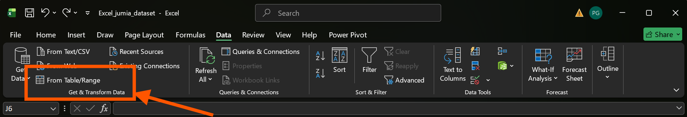
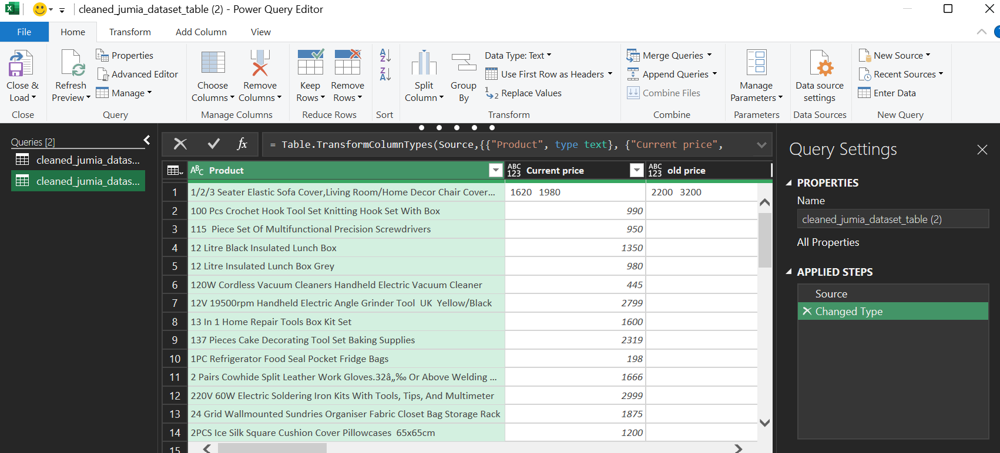
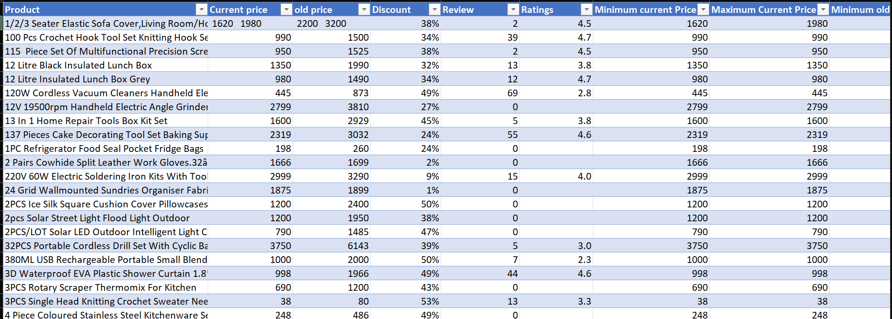
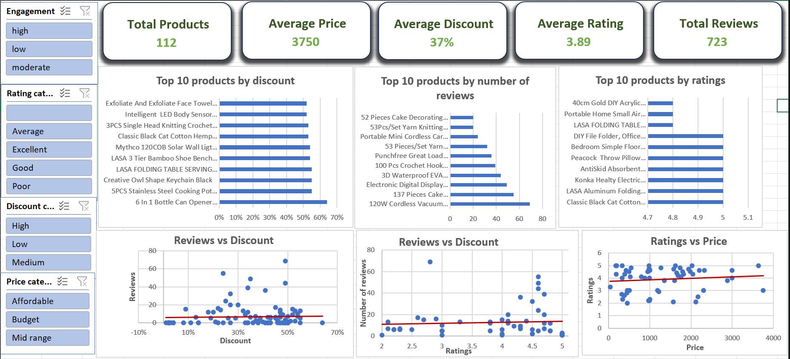

# Jumia_Products_Performance_Dashboard
## Contents
1. [Project Overview](#1-project-overview)
2. [Concepts Covered](#2-concepts-covered)
3. [Project Structure](#3-project-structure)
4. [Data Analysis](#4-data-analysis)
5. [Findings and Recommendations](#5-findings-and-recommendations)
## 1. Project Overview
The aim of this project is to use excel to analyze data from Jumia - an online e-commerce platform - to determine how product performance is impacted by discounts, pricing strategies, and customer feedback.
## 2. Concepts Covered
1. Excel Functions
2. xlookup
3. Pivot Tables
4. Pivot Charts
5. Power Query
6. Excel Tables
7. Excel Dashboards
## 3. Project Structure
The excel workbook contains 7 worksheets:

|Worksheet|Contents|
|---------|-------|
|Excel_jumia_dataset_raw| Raw CSV data from the platform|
|Excel_jumia_dataset_cleaned| Final transformed table to be used for analysis|
|Cleaning_log| A list of transformations carried out on the raw dataset to form the transformed table|
|Statistics| Descriptive statistics extracted from the transformed data|
|Relationship_analysis| Charts modelling the relationship between different fields
|Dashboard| A visual representation of the defined KPIs, charts, and categorical slicers|
|Findings and Recommendations| A list of findings and recommendations based on the analysis conducted|
## 4. Data Analysis
The analytical process involved 3 main steps:
1. Data cleaning and Transformation
2. Descriptive and correlation analysis
3. Dashboard Development
### Data Cleaning and Transformation
Once the raw data has been uploaded to excel, [__power query__](https://support.microsoft.com/en-us/excel/about-power-query-in-excel) was used to carry out the data cleaning and transformations. It can be accessed by navigating to `Data > Get & Transform Data > From table/range`. 
<figure>

<figcaption>Get & Transform data<figcaption>
</figure>

<figure>

<figcaption> power query window</figcaption>
</figure>

Within power query the following transformations were carried out:
1. Handling of duplicate and missing values
2. Handling of inconsistent data formats, data types, values, and prefixes
3. Enriching the table by adding columns like discount amount, and categorizing discount, ratings, and engagement. 

The outcome is an excel table containing all the changes made from power query.
<figure>

<figcaption>Transformed table</figcaption>
</figure>

Once all the transformation were completed and validated, the steps were logged into a table inside the [cleaning_log worksheet](./Excel_jumia_dataset.xlsx).
### Descriptive and correlation analysis
This involved analyzing the transformed data table to generate some meaningful statistics and demonstrating the correlation between various features. [__pivot tables__](https://www.w3schools.com/excel/excel_table_pivot_intro.php) generated from the transformed data table were implemented to carry out the analysis. 
The following statistics were obtained from the analysis using the pivot tables inside the [statistics worksheet](./Excel_jumia_dataset.xlsx):
1. General statistics
    - Averages: current price, old price, discount, discount amount, ratings
    - Maximum and minimum prices
    - Total number of products
    - Sum of reviews
2. Top 10 products by discount, ratings, and reviews
3. Bottom 5 products by discount, ratings, and reviews.

Correlation analysis was carried out to determine how several features relate to each other and the degree to which one variable affects another. This was implemented using [__scatter plots__](https://support.microsoft.com/en-us/excel/present-your-data-in-a-scatter-chart-or-a-line-chart) inside the [Relationship analysis worksheet](./Excel_jumia_dataset.xlsx). The following relationships were analyzed:
- Reviews based on discount
- Reviews based on ratings
- Ratings based on price

Since scatter plots cannot be generated dirrectly from pivot tables, a helper table was implemented which referenced the pivot table. Referencing values from the pivot table was made possible by using [__xlookup__](https://support.microsoft.com/en-us/excel/functions/xlookup-function) and the [__GetPivotData()__](https://support.microsoft.com/en-us/excel/functions/getpivotdata-function) formulas in excel.

### Dashboard development
After carrying out the analysis, The various statistics and relationships are consolidated into one single page that can be presented to various stakeholder like the marketing team and sellers on the platform. 
The dashboard inside the [dashboard worksheet](./Excel_jumia_dataset.xlsx) includes 4 main sections: 
1. Key Performance Indicators (KPIs) 
2. Product performance
3. Trends
4. Slicers
#### KPIs
This section includes metrics that determine how well the products align with the business goals
The KPIs included in the dashboard are: Total number of products, Average price, Average discount, Average rating, and the sum of the reviews.
#### Performance Indicators
This  section includes charts indicating the top 10 and bottom 5 products based on discount, ratings, and reviews.
#### Trends
The scatter plots that were created in the relationship analysis section above, are placed in this section.
#### Slicers
The slicers are filtering tools based on several meaningful categories. the categories used to create the slicers are: ratings, price, engagement, and discount.
<figure>

<figcaption>Final dashboard</figcaption>
</figure>

## 5. Findings and Recommendations
### Findings
The analysis carried out led me to the following findings:
1. Reviews have a very weak positive relationship with discount (r=0.03). Consequently, a very tiny fraction of discounts affect reviews (R² = 0.00069)
2. Ratings have a weak positive relationship with pricing (r=0.06). A small fraction of pricing affects reviews (R²= 0.0032)
3. Some of the highly discounted products have a poor ratings
Most of the highly discounted prices have very low engagement
4. Most of the highly discounted prices have very low engagement
5. 4 products have both high engagement and excellent ratings
### Recommendations
The following are my recommendations based on my findings:
1. Discounts should not be used as the primary engagement strategy.
2. Pricing should be slightly considered alongside other factors to improve customer satisfaction.
3. The pricing strategies for products with high discounts but poor ratings should be reviewed, and other factors, such as product quality, should be taken into consideration when trying to improve customer satisfaction.
4. Avoid further discount increases and consider other strategies to improve the popularity of products with high discounts and low engagements.
5. Investigate what makes products with high engagements and excellent ratings popular with customers and apply the finding to other related products.
All these recommendations and findings are recorded in a table inside the [findings and recommendations worksheet](./Excel_jumia_dataset.xlsx)